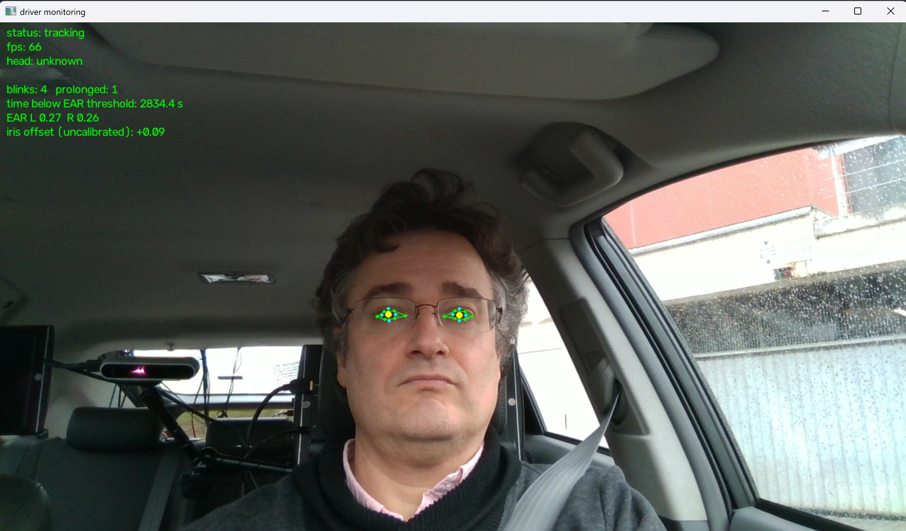
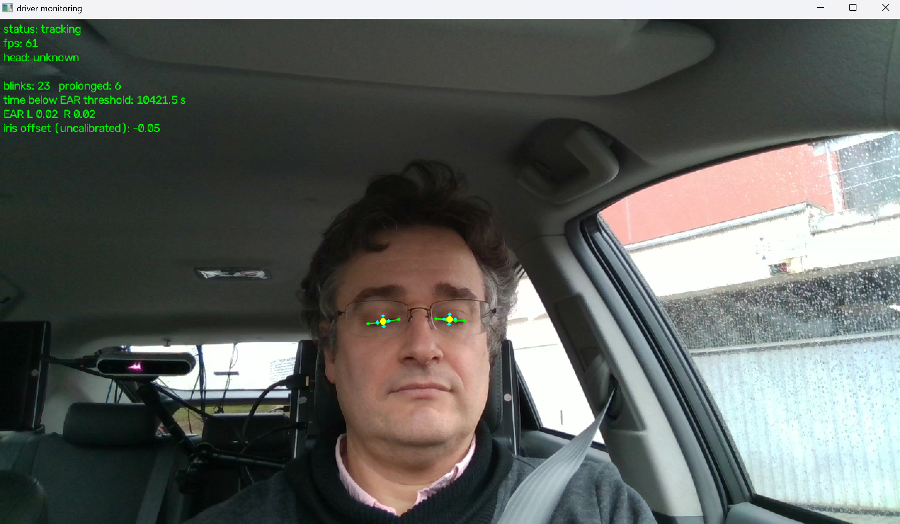

# Gaze tracking for driver monitoring system

A small demo: approximate **head orientation**, **blink /
eye-closure** tracking and **eye/iris landmark overlay** from a laptop webcam
(or a video file). Built with Python, OpenCV and MediaPipe Face Landmarker.

## Screenshots





## Setup

```powershell
py -m venv .venv
.venv\Scripts\pip install -r requirements.txt
```
